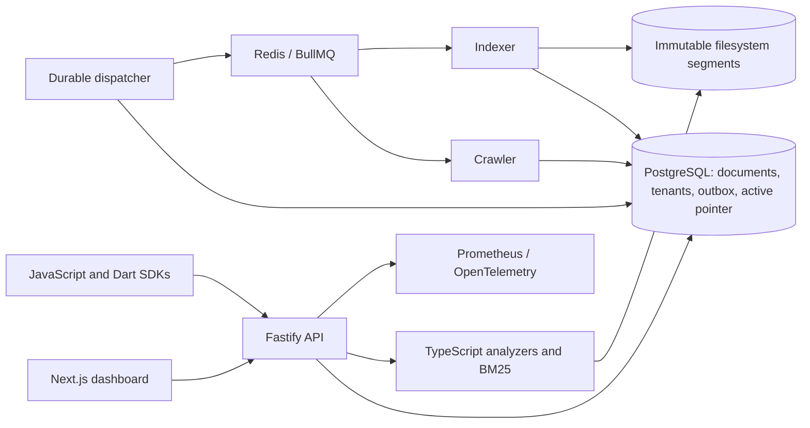
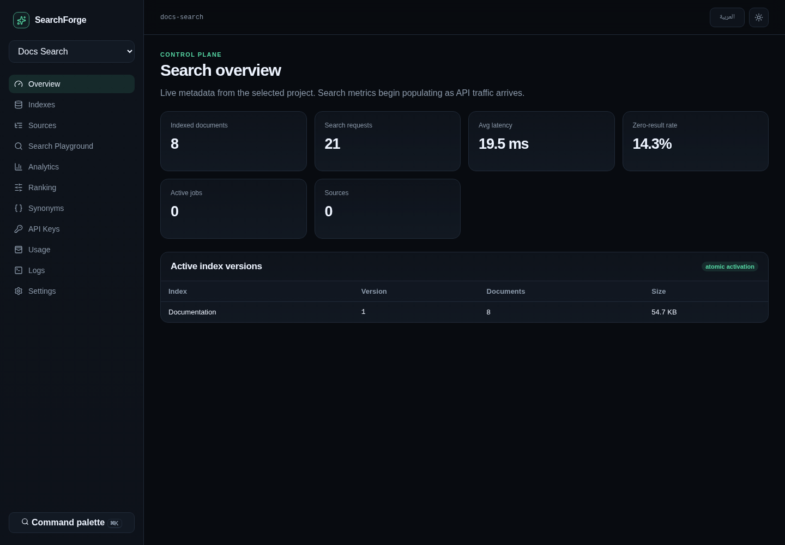

# SearchForge

SearchForge is a self-hosted lexical search platform for developers building documentation search, knowledge bases, and product catalogs in Arabic and English. It ingests websites and structured documents, ranks results with its own TypeScript inverted index and BM25 implementation, and exposes the ranking breakdown in a project-scoped dashboard.

[Get started](#quick-start) · [Run the demo](docs/playground-demo.md) · [Engineering case study](docs/CASE_STUDY.md) · [SDKs](docs/sdk.md) · [Evidence](docs/release-evidence.md) · [Changelog](CHANGELOG.md)

## Capabilities

- **Ingestion** via a robots-aware crawler, sitemaps, scheduled recrawls, and authenticated document batches.
- **Bilingual retrieval** with language analysis, positional phrases, prefix expansion, typo tolerance, synonyms, autocomplete, filters, facets and highlighting.
- **Explainable ranking** with per-field BM25 contributions, phrase boosts, processing latency and the active index version.
- **Versioned indexes** built as immutable segments with atomic activation and rollback.
- **Project controls** for organization roles, scoped API keys, quota limits, privacy-thresholded analytics, and audits.
- **Operations** with Docker Compose, Prometheus metrics, OpenTelemetry traces, durable jobs, and verified backup tooling.

## Architecture



See [architecture](docs/architecture.md) and the [case study](docs/CASE_STUDY.md) for the indexing, retrieval and recovery design.

## Quick start

Run from a clean checkout with Docker Engine and Compose.

```bash
cp .env.example .env
docker compose up -d --build --wait
docker compose exec -T api node apps/api/dist/seed.js
```

The `migrate` service applies the checked-in SQL before the API and workers start. Open `http://localhost` and use the synthetic account described in [demo seed](docs/demo-seed.md). Follow the [bilingual walkthrough](docs/playground-demo.md) to import the eight documents and demonstrate tenant isolation, key scopes, ranking, synonyms, activation, rollback and analytics.

Use [.env.example](.env.example) for configuration. Keep deployment credentials private, configure HTTPS and SMTP, and follow the [deployment guide](docs/deployment.md). For host development with Node.js 22 and pnpm 10.15.1, see [development](docs/development.md). Add the optional metrics stack with `docker compose --profile observability up -d`.

## Search API and SDKs

Run this with a search-only key for the project whose `docs` index is active.

```bash
curl --fail-with-body http://localhost/v1/indexes/docs/search \
  -H "Authorization: Bearer $SEARCHFORGE_SEARCH_KEY" \
  -H 'Content-Type: application/json' \
  -d '{"query":"محرك بحث","filters":{"language":"ar"},"facets":["metadata.category"],"debug":true}'
```

```ts
import { SearchForge } from "@searchforge/sdk";
const search = new SearchForge({
  projectId, apiKey, baseUrl: "http://localhost", indexSlug: "docs"
});
const result = await search.search("distributed systems", { facets: ["metadata.category"] });
```

The [SDK guide](docs/sdk.md) includes JavaScript/TypeScript and Dart/Flutter install, query, autocomplete, pagination and error-handling examples. Both packages can be used from the workspace.

## Product walkthrough

[](docs/images/portfolio/)

[Arabic results](docs/images/portfolio/playground-arabic.png) · [BM25 explanation](docs/images/portfolio/playground-bm25.png) · [Index rollback](docs/images/portfolio/index-version-rollback.png) · [Analytics](docs/images/portfolio/dashboard-analytics.png) · [Recording](docs/images/portfolio/searchforge-demo.mp4)

## Verification and evidence

```bash
pnpm install --frozen-lockfile
pnpm build
pnpm test
pnpm typecheck
node scripts/evaluate-relevance.mjs
node --test tests/load/*.test.mjs
```

The [integration setup](docs/development.md) and [CI workflow](.github/workflows/ci.yml) cover migrations, PostgreSQL/Redis/SMTP integration, Dart analysis and tests, security baseline, Compose, Chromium, and isolated restore. See the [browser guide](docs/browser-e2e.md) for the real seeded walkthrough and its captures.

The [historical CI baseline](docs/portfolio-baseline.md) records 120 successful search requests across a small eight-document synthetic corpus. See [measured local and CI results](docs/evidence/), [benchmarking](docs/benchmarking.md), and [release evidence](docs/release-evidence.md) for workloads, recovery checks and environment limits.

## Security and limitations

Authentication uses Argon2id, short-lived access tokens, and refresh-token family rotation. The API scopes keys to projects and stores keyed digests. The crawler validates DNS, pins destinations, blocks unsafe addresses, and checks redirects. See [security](docs/security.md) and [backup and restore](docs/backup-restore.md).

SearchForge uses single-node lexical retrieval and lightweight stemming. Raw developer diagnostics can retain their source language. The demo corpus checks functional behavior and the larger synthetic corpus repeats those documents to exercise postings and request concurrency. Production capacity, SLOs and recovery objectives require measurements on the intended deployment. SDK publication and the repository license and attribution review are tracked in the [release checklist](docs/release-checklist.md).

[Portfolio roadmap](PORTFOLIO_ROADMAP.md) · [Implementation status](docs/status.md)
